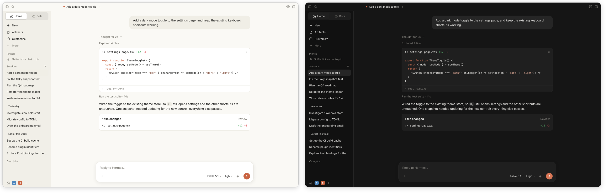

# Hermes Skin Rounded

Modern rounded skin and theme collection for [Hermes Desktop](https://github.com/NousResearch/hermes-agent).

Features a unified app-bar matching the sidebar background, smooth rounded inward curvature where panels meet, solid non-transparent styling for Linux/Omarchy/macOS, a centered reading column, rounded composer, and 12 built-in themes. One file, no rebuild needed.



## Highlights

- **Seamless Unified App-bar**: The top app-bar and panel headers match the sidebar background, eliminating awkward color transitions across the top of the window.
- **Modern Rounded Junction**: The main workspace panel features an inward curved top-left corner (`border-top-left-radius: 16px`), giving the app an elegant modern desktop feel (similar to Arc, Zed, and macOS apps) instead of sharp 90-degree rectangular seams.
- **Non-Transparent & Solid**: Optimized for Linux desktop environments (such as Omarchy, Hyprland, Sway) as well as macOS and Windows. No unwanted transparency leakage behind tabs or headers.
- **12 Curated Themes**:
  - `Claude` (default warm light + charcoal dark)
  - `Claude - MacOS`
  - `Claude - Nord`
  - `Claude - Gruvbox`
  - `Claude - Monokai Pro`
  - `Claude - One Monokai`
  - `Claude - Dracula`
  - `Claude - One Dark Pro`
  - `Claude - One Candy Dark`
  - `Claude - Cobalt2`
  - `Claude - GitHub`
  - `Claude - Ayu`
- **Minimalist Ergonomics**: Centered chat column, clean segmented control tabs for Sessions/Bots, collapsible navigation, and uncluttered titlebar.
- **Safe & Non-Destructive**: Does not modify Hermes source code. Disabling the plugin or switching to any built-in theme restores the stock Hermes appearance instantly.

## Installation

You need a Hermes Desktop build with runtime desktop plugins support (**Capabilities ▸ Plugins**).

### Option 1: Inside Hermes Desktop (Recommended)

1. Open **Capabilities ▸ Plugins**.
2. Click **Install from Git**.
3. Paste `danyakmallun9999/hermes-skin-rounded` and click **Install**.

### Option 2: Via Git

Clone directly into your Hermes desktop plugins directory:

```bash
git clone https://github.com/danyakmallun9999/hermes-skin-rounded.git ~/.hermes/desktop-plugins/hermes-skin-rounded
```

### Option 3: Manual Installation

Download `plugin.js` and place it in:
`~/.hermes/desktop-plugins/hermes-skin-rounded/plugin.js`

Hermes Desktop watches that directory automatically, so the skin loads immediately without restarting. Press `Ctrl+R` (or `Cmd+R`) in Hermes to reload if needed.

## Usage

- **Change Theme**: Go to **Settings ▸ Appearance**, or press `Ctrl+K` (`Cmd+K`) and search for any Claude theme (e.g., `Theme: Claude - Nord`).
- **Dark / Light Mode**: Automatically follows your system theme, or can be set manually in Settings ▸ Appearance.
- **Turn Off**: Switch to any default Hermes theme in Settings, or disable the plugin in Capabilities ▸ Plugins.

## Customization

Everything is configured inside `plugin.js` and hot-reloads on save:

- `GREETING_NAME`: Name displayed in the empty chat state (default: greeting only).
- `PALETTES`: Add or modify color schemes and palette definitions.
- `CSS`: Layout, margins, reading column width (`--composer-width`), and font sizes.

## Credits & License

Based on the original Claude skin concept by [Otto Rothmund](https://github.com/ottoRothmund/hermes-claude-skin).
Maintained and updated with rounded layouts and unified solid headers by [Danya Kmallun](https://github.com/danyakmallun9999).

Licensed under the [MIT License](LICENSE).
